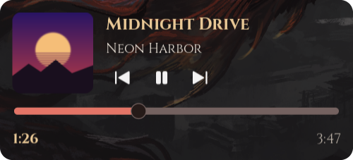

# Noctalia Media Card

**A lock-screen media player for the Noctalia shell, with cover art, playback controls and a working seek bar. It keeps showing the right track even when Firefox/Zen's single MPRIS player gets hijacked.**

<p align="center">
  <br>
  <sub>Demo track and cover, rendered by the plugin on the Noctalia desktop.</sub>
</p>

---

## Why

Noctalia's built-in `media_player` widget (v5.4) has no seek bar. Browser music also has a known problem: Firefox and its forks (Zen, LibreWolf, Floorp) expose **one MPRIS player for all tabs**. A short sound in another tab, such as a 2-second WhatsApp notification, can take that player and keep it while your music keeps playing. Every MPRIS-based widget then shows the wrong tab as "Paused" or shows nothing.

This is tracked upstream in [Mozilla Bug 1710229](https://bugzilla.mozilla.org/show_bug.cgi?id=1710229) and [Bug 1615665](https://bugzilla.mozilla.org/show_bug.cgi?id=1615665). The media controller is only released when its tab closes.

Media Card cross-checks MPRIS against the real audio streams in PipeWire/PulseAudio. It shows what is actually playing.

---

## Architecture

```
Noctalia lock screen
  └─ desktop.luau  (render-only Luau widget)
        ▲  JSON line on change / every 1 s          │ playerctl -p <player> play-pause | next | position …
        │                                           ▼
     probe.py  (long-lived helper, started via noctalia.runStream)
        ├─ playerctl -a metadata          → every MPRIS player
        ├─ pactl -f json list sink-inputs → real, uncorked audio streams
        └─ ~/.cache/noctalia-seekbar/     → cover copies + per-track length cache
```

The decision logic lives in `probe.py`, so you can test it outside the lock screen (`python3 probe.py --once`). The Luau widget only draws the card and sends commands.

---

## Quick Start

### 1. Requirements

- Noctalia **v5.4+** (plugin API 43)
- `python3`, `playerctl`, `pactl` (`pipewire-pulse` or PulseAudio)

```bash
# Arch / CachyOS
sudo pacman -S playerctl libpulse
```

### 2. Install

```bash
git clone https://github.com/Anka256/Noctalia-Media-Card.git
cd Noctalia-Media-Card
./install.sh                      # copies the plugin to ~/.local/share/noctalia/plugins/seekbar
noctalia msg plugins enable onur/seekbar
```

### 3. Put it on the lock screen

Add a lock-screen widget in `~/.local/state/noctalia/settings.toml`. Give it an explicit box and turn off Noctalia's own background, because the card draws its own:

```toml
[lockscreen_widgets]
widget_order = [ "...your widgets...", "lockscreen-widget-media-card" ]

    [lockscreen_widgets.widget.lockscreen-widget-media-card]
    type = "onur/seekbar:seek"
    box_width = 400.0
    box_height = 182.0
    cx = 232.0          # centre, logical px
    cy = 123.0
    output = "eDP-1"

        [lockscreen_widgets.widget.lockscreen-widget-media-card.settings]
        background = false
```

Then run `noctalia msg config-reload` and lock with `Super+L`. The same `type` also works as a desktop widget.

---

## How It Works

`probe.py` polls every 0.3 s and picks the first match:

| Priority | Situation | Card |
|---|---|---|
| 1 | You paused a player from the card (within the last 10 min) | That player, paused, fully interactive |
| 2 | A native player (Spotify app, mpv, …) is playing | Full card |
| 3 | Browser MPRIS is playing and matches a real audio stream | Full card |
| 4 | Browser MPRIS says *Paused* but the same title is audibly playing | Treated as playing (hides Zen's pause blip on track switch) |
| 5 | Browser MPRIS is stale, but a tab is playing `Title - Artist - Deezer` | **Stream mode**: real title/artist, cached cover/length, controls dimmed |
| 6 | Anything paused | Paused card |
| — | Nothing | Card hidden |

MPRIS entries 10 s or shorter are ignored as notification sounds.

**Stream mode** comes from the browser stream's `media.name`. Deezer's format, `Title - Artist - Deezer`, is parsed fully. For YouTube, SoundCloud, Spotify Web, Tidal and similar services, only the title is extracted. Controls are disabled in this mode, because the browser does not let anything outside it control the hidden tab. To get them back, play/pause the music once in the browser.

### Details that matter

- **Covers.** Browsers delete their temporary cover file on every track change. The probe copies each cover into its own cache the moment it appears.
- **Seeking.** It never seeks to exactly `0`, which Firefox ignores. The handle stays at the target until the player confirms it, so it does not jump back.
- **Fixed layout.** Every width is fixed, so long titles never resize or shift the card.

---

## Customising

The colours, font and card size are constants at the top of `desktop.luau`:

```lua
local GOLD = "#e9c896"
local TEXT = "#ece4da"
local DIM  = "#bdb3a8"
local FONT = "Cinzel"
local CARDW, CARDH, PAD = 400, 182, 14
```

Luau edits hot-reload. Changes to `plugin.toml` need `noctalia msg config-reload`.

---

## Testing

Lock-screen widgets only run while the screen is locked. To test, place the widget temporarily in `[desktop_widgets]` and run:

```bash
tests/e2e.sh
```

The script starts a silent fake MPRIS player (`tests/fakempris.py`). It then drives the card through the plugin's IPC hooks: pause, resume, next, previous, seek, and player shutdown. It prints the state the card rendered after each step and the number of Luau errors.

You can also drive the hooks by hand:

```bash
noctalia msg plugin onur/seekbar:seek all debug on   # log every render
noctalia msg plugin onur/seekbar:seek all toggle     # also: next, prev, drag <sec>, end
```

---

## License

MIT
